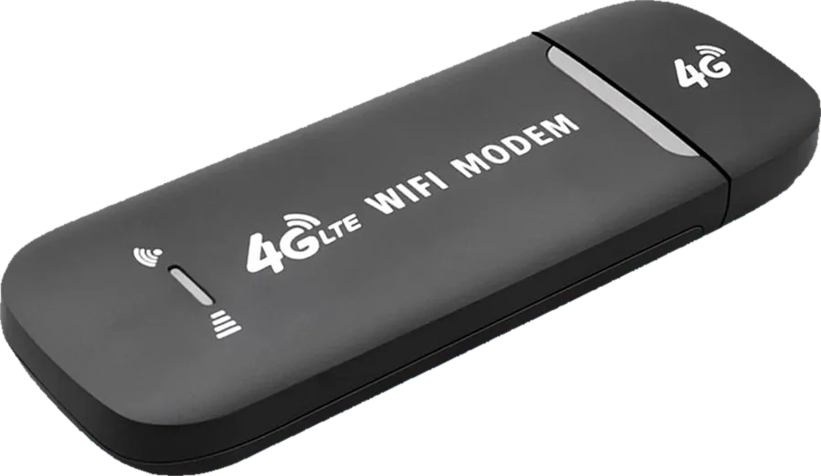
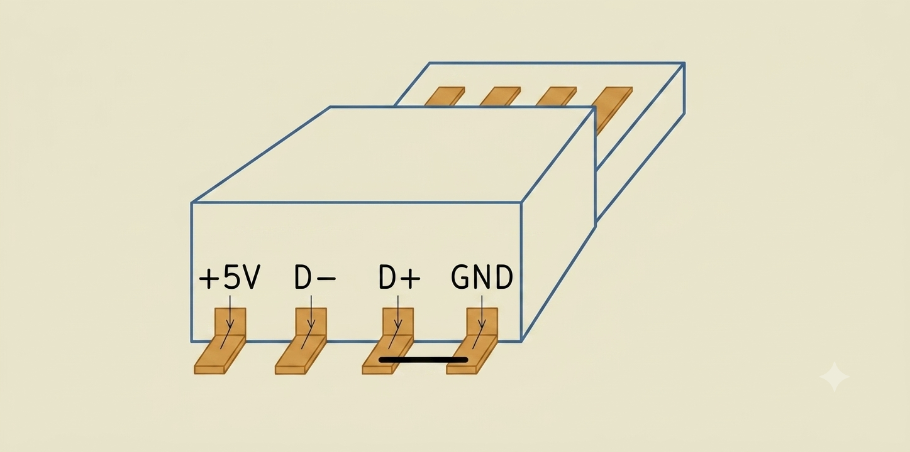

<div align="center">



# OpenWrt-Liberty для UZ801 v3.2

**Кастомная прошивка OpenWrt для 4G LTE-донгла UZ801 v3.2, полностью управляемая через
LuCI** — карманный дорожный роутер и инструмент обхода блокировок. Все возможности
настраиваются из веб-интерфейса; для повседневной работы командная строка не нужна.

[](https://openwrt.org/)
[](https://www.kernel.org/)
[](https://ru.wikipedia.org/wiki/Snapdragon)
[](../firmware)
[](#хост)

[English](../README.md) · **Русский**

</div>

---

В репозитории лежат готовый образ прошивки и скрипты резервного копирования, прошивки и
отката донгла.

| | |
|---|---|
| **Основа** | OpenWrt 25.12.5 (ядро 6.12), брендирование `OpenWrt-Liberty` |
| **Target** | `msm89xx / msm8916`, `aarch64`, профиль устройства `yiming-uz801v3` |
| **Железо** | Qualcomm MSM8916 (Snapdragon 410), 384 МБ ОЗУ, 4 ГБ eMMC, плата `FY_UZ801_V3.2` |
| **Готово к заливке** | образ лежит в [`firmware/`](../firmware) — достаточно клонировать репозиторий |
| **Управление** | LuCI по адресу `http://192.168.1.1` через USB-гаджет |

## Содержание

- [Быстрый старт](#быстрый-старт)
- [Возможности](#возможности)
  - [Инструкции по приложениям Liberty](liberty/README.ru.md)
- [Структура репозитория](#структура-репозитория)
- [Сводка команд](#сводка-команд)
- [Требования](#требования)
  - [Хост](#хост)
  - [Программы — автоматическая установка](#программы--автоматическая-установка)
  - [Доступ к EDL-устройству по USB (для каждой ОС)](#доступ-к-edl-устройству-по-usb-для-каждой-ос)
  - [Оборудование](#оборудование)
- [Вход в режим EDL](#вход-в-режим-edl)
- [Процедура A — установка OpenWrt-Liberty на заводской донгл](#процедура-a--установка-openwrt-liberty-на-заводской-донгл)
- [Процедура B — восстановление заводской прошивки](#процедура-b--восстановление-заводской-прошивки)
- [Файлы образа прошивки](#файлы-образа-прошивки)
- [Диагностика неполадок](#диагностика-неполадок)
- [Особенности и ограничения железа](#особенности-и-ограничения-железа)
- [Благодарности](#благодарности)

---

## Быстрый старт

**Готовый к заливке образ прошивки закоммичен в репозиторий, в
[`firmware/`](../firmware).** Поэтому для подготовки донгла достаточно клонировать
репозиторий.

```sh
git clone <этот-репозиторий>
cd <корень-репозитория>

./backup-stock.sh       # 1. резервная копия заводской прошивки  (донгл в EDL)
./flash-firmware.sh     # 2. заливка готового образа             (донгл в EDL)
```

Это вся процедура. `flash-firmware.sh` берёт образы прямо из `firmware/`; любая нужная
утилита (`edl`, `python3`, `adb`) скачивается в `temp/` автоматически при первом запуске.

| | |
|---|---|
| **Поставляемый образ** | `openwrt-liberty-25.12.5-msm89xx-msm8916-yiming-uz801v3` (~78 МБ, 7 файлов) |
| **Один образ для всех экземпляров** | индивидуальные данные (IMEI, калибровка радиоблока) считываются с самого донгла во время прошивки, а не берутся из образа |
| **Список пакетов** | см. файл `*.manifest` в [`firmware/`](../firmware) — каждый пакет и его версия в образе |

Подробная пошаговая инструкция, включая перевод донгла в режим EDL, — в
[Процедуре A](#процедура-a--установка-openwrt-liberty-на-заводской-донгл).

---

## Возможности

### Liberty — отдельный раздел меню

Все приложения обхода блокировок, VPN и прокси собраны в один раздел верхнего уровня
**Liberty** в LuCI и отсортированы по алфавиту. Приложения, которые не установлены,
пропускаются автоматически.

| Приложение | Назначение |
|---|---|
| **AmneziaWG** | обфусцированный WireGuard (устойчив к DPI); модуль ядра соответствует точному vermagic ядра этой прошивки |
| **OpenVPN** | классический VPN-клиент/сервер |
| **PassWall** | интерфейс к xray-core — VLESS + Reality + XHTTP и другие современные транспорты |
| **Tailscale** | mesh-VPN без настройки |
| **WireGuard** | обычный WireGuard |
| **Zapret** | обход DPI без прокси-сервера |

**[→ Инструкции по каждому приложению Liberty](liberty/README.ru.md)** — отдельная
инструкция на приложение, со снимками экрана с работающего донгла: как настроить, как
пустить через него весь трафик и как добиться, чтобы при его падении ничего не утекало.

### Модем

- **Services → SMS** — почтовый ящик модема: папки Inbox / Outbox / Drafts, вид
  «Переписки», архив на самом устройстве, не ограниченный памятью симкарты, и
  USSD-сессии для запросов баланса и пакетов. Всё идёт через ModemManager, отдельный
  AT-порт не нужен.
- **ModemManager** с поддержкой QMI, MBIM, QRTR и интеграцией с netifd.

### Сеть и мониторинг

| Пакет | Назначение |
|---|---|
| **vnstat2** | долговременная статистика трафика по интерфейсам |
| **nlbwmon** | учёт трафика по узлам сети |
| **https-dns-proxy** | DNS поверх HTTPS |
| **SQM** | управление очередями, борьба с bufferbloat |
| **adblock-fast** | блокировка рекламы (именно реклама, не обход блокировок) |
| **watchcat** | контроль связи и перезагрузка по расписанию |
| **usb-gadget** | режимы NCM / RNDIS / накопитель / ACM-консоль, настраиваются из LuCI |
| **zram-swap** | сжатый swap в ОЗУ (у устройства 384 МБ) |

---

## Структура репозитория

```
firmware/                     готовый к заливке образ — можно прошивать сразу из клона
docs/                         материалы документации и русский README

backup-stock.sh               полный бэкап заводского донгла через EDL
flash-firmware.sh             заливка firmware/ на донгл через EDL
restore-stock.sh              откат донгла к заводской прошивке из бэкапа
```

За пределы каталога репозитория ничего не пишется.

---

## Сводка команд

```sh
cd <корень-репозитория>

# Заводской донгл -> OpenWrt-Liberty (используется готовый образ из firmware/):
[EDL]  ./backup-stock.sh      # 1. бэкап заводской прошивки
[EDL]  ./flash-firmware.sh    # 2. заливка

# Откат к заводской прошивке:
[EDL]  ./restore-stock.sh     # восстановление из бэкапа
```

`[EDL]` означает, что перед выполнением команды донгл должен быть переведён в режим EDL
(перемыкание D+/GND в момент подключения).

---

## Требования

Этот раздел и две процедуры ниже описывают полный процесс подготовки донгла UZ801 v3.2:
резервное копирование заводской прошивки, установку кастомной прошивки OpenWrt-Liberty и
восстановление заводской прошивки при необходимости. Процедура выполняется тремя
скриптами и не требует программирования.

Все экземпляры UZ801 v3.2 используют один и тот же образ прошивки. Индивидуальные данные
(IMEI, калибровка радиоблока) в образе не содержатся — они сохраняются из собственных
разделов устройства во время прошивки.

### Хост

Скрипты написаны на POSIX shell и работают на **macOS, Linux и Windows**. В Windows их
следует запускать из POSIX-окружения — **MSYS2**, **Git Bash** или **WSL**. Клонируйте
репозиторий; далее его каталог называется *корнем репозитория*.

### Программы — автоматическая установка

Скрипты прошивки при первом запуске сами устанавливают всё, чего им не хватает, **в
каталог `temp/` внутри проекта**. Больше нигде на машине ничего не создаётся, а `temp/`
игнорируется гитом; его можно удалить в любой момент, чтобы освободить место (он будет
создан заново по необходимости).

| Утилита | Назначение | Если отсутствует |
|------|---------|-----------|
| `bash` | запускает скрипты | установить вручную (в Windows — MSYS2 / Git Bash / WSL) |
| `git`, `curl` | скачивают утилиты ниже | установить вручную (обычно уже есть) |
| `python3` | среда выполнения для `edl` | автономный дистрибутив Python скачивается в `temp/python` |
| `edl` | утилита прошивки через EDL | устанавливается в `temp/edl`; переменная `EDL_BIN` позволяет использовать уже установленную |
| `adb` | автоматический вход в EDL со стока; переформатирование userdata/cache при откате | Android platform-tools скачиваются в `temp/platform-tools` |
| `libusb` | нативный USB-бэкенд для `edl` | установить через пакетный менеджер, только если edl сообщает об отсутствии USB-бэкенда (macOS: `brew install libusb`; Linux: `apt install libusb-1.0-0`) |

На чистой машине обычно нужны только `bash`, `git`, `curl` и (в Windows) USB-драйвер
ниже — всё остальное скачивается в `temp/` при первом запуске.

### Доступ к EDL-устройству по USB (для каждой ОС)

- **macOS** — работает сразу, драйвер не нужен.
- **Linux** — установите `usbutils` (для `lsusb`). Дайте доступ к EDL-устройству
  (`05c6:9008`) и к adb: либо запускайте скрипты через `sudo`, либо добавьте правило
  udev:
  ```
  # /etc/udev/rules.d/51-edl.rules
  SUBSYSTEM=="usb", ATTR{idVendor}=="05c6", ATTR{idProduct}=="9008", MODE="0660", GROUP="plugdev"
  ```
  затем `sudo udevadm control --reload && sudo udevadm trigger`.
- **Windows** — EDL-устройству нужен драйвер **WinUSB / libusb**: запустите
  [Zadig](https://zadig.akeo.ie/), выберите устройство `QHSUSB__BULK` (9008) и установите
  на него драйвер **WinUSB** (или libusb-win32). Для adb установите Google USB Driver.
  Скрипты запускайте из MSYS2 / Git Bash / WSL.

### Оборудование

- Донгл UZ801 v3.2.
- Тонкий металлический предмет (пинцет, разогнутая скрепка или лезвие ножа), чтобы
  кратковременно перемкнуть два контакта разъёма (см. [Вход в режим EDL](#вход-в-режим-edl)).

Переходите в корень репозитория один раз за сессию терминала; все команды ниже
выполняются оттуда:

```sh
cd <корень-репозитория>
```

---

## Вход в режим EDL

Для прошивки и восстановления донгл должен находиться в режиме **EDL** (Emergency
Download), в котором он определяется по USB как `05c6:9008` (QHSUSB__BULK). Вход в EDL
выполняется кратковременным перемыканием выводов **D+** и **GND** USB-разъёма донгла в
момент подключения к хосту.

<div align="center">

</div>

Донгл заканчивается **штекером USB Type-A**. Как показано на схеме, у его четырёх
контактов есть две разные стороны:

- **контактная площадка** — четыре плоских золочёных контакта, которые входят в USB-порт;
- **выводы под распайку** — те же четыре вывода там, где они выходят из разъёма и
  припаяны к плате донгла.

Назначение выводов (стандарт USB Type-A):

| Вывод | Сигнал | Положение |
|-----|--------|----------|
| 1 | +5V (VBUS) | крайний |
| 2 | D− | внутренний |
| 3 | **D+** | внутренний |
| 4 | **GND** | крайний |

Для входа в EDL перемкните **вывод 3 (D+)** с соседним **выводом 4 (GND)** — внутренний
контакт и крайний контакт рядом с ним, на одном конце разъёма.

> **Как определить нужный конец.** Две линии данных (D−, D+) — внутренняя пара; +5V и GND
> — крайние. Нужно перемкнуть D+ с той GND, которая находится рядом с ним, то есть одну
> крайнюю пару (выводы 3+4), а не другую (выводы 1+2). Убедитесь в выборе пары до касания
> контактов — перемыкание не той пары замыкает шину +5V.

### Порядок действий

1. Извлеките донгл из хоста.
2. Расположите металлический предмет так, чтобы он одновременно замыкал **вывод 3 (D+) и
   вывод 4 (GND)**.
3. Удерживая замыкание, вставьте донгл в USB-порт.
4. Примерно через две секунды уберите инструмент.

Убедитесь, что хост показывает устройство `9008`. Если нет — извлеките донгл и повторите.
**Не удерживайте замыкание дольше трёх-четырёх секунд.**

---

## Процедура A — установка OpenWrt-Liberty на заводской донгл

Выполняйте шаги по порядку.

### Шаг 1 — резервная копия заводской прошивки

> **Этот бэкап — единственный путь назад к заводской прошивке. Не пропускайте его.** В
> нём также хранятся собственный IMEI устройства и данные калибровки радиоблока —
> сохраните полученный каталог в надёжном месте.

1. Переведите донгл в режим EDL.
2. Выполните:
   ```sh
   ./backup-stock.sh
   ```
   Скрипт считывает все разделы в `backup/stock-<метка-времени>/` (несколько минут) и при
   успехе сообщает `Backup complete`.

### Шаг 2 — прошивка

1. Снова переведите донгл в режим EDL (после бэкапа он выходит из EDL).
2. Выполните:
   ```sh
   ./flash-firmware.sh
   ```
3. Подтвердите вводом `y`. Скрипт сохраняет разделы радиоблока данного устройства
   (сохраняя его IMEI), записывает образ и перезагружает донгл.

Устанавливаемый образ **чистый**: никакие пользовательские настройки (Wi-Fi, сеть,
пароли) в него не зашиты. Они хранятся в overlay-разделе, который при прошивке стирается,
поэтому донгл загружается с настройками OpenWrt по умолчанию.

### Шаг 3 — проверка

Донгл загружается автоматически. Примерно через минуту откройте в браузере:

```
http://192.168.1.1
```

Войдите как `root` с пустым паролем. Это интерфейс OpenWrt-Liberty.

---

## Процедура B — восстановление заводской прошивки

1. Переведите донгл в режим EDL.
2. Выполните (по умолчанию скрипт берёт самый свежий бэкап в `backup/`):
   ```sh
   ./restore-stock.sh
   ```
   Чтобы выбрать конкретный бэкап:
   ```sh
   ./restore-stock.sh backup/stock-20260722-190000
   ```
3. Подтвердите вводом `y`. Скрипт записывает заводские разделы, переформатирует служебные
   разделы (userdata, cache) и перезагружает устройство.
4. Примерно через минуту донгл поднимает заводскую сеть Wi-Fi `4G-UFI-FE9` (пароль WPA2
   `1234567890`); его веб-интерфейс доступен по адресу `http://192.168.100.1`.

---

## Файлы образа прошивки

Образ в `firmware/` состоит из следующих файлов:

| Файл | Назначение |
|---|---|
| `*-squashfs-sysupgrade.bin` | образ sysupgrade (обновление из работающего OpenWrt) |
| `*-squashfs-system.img` | корневая файловая система, её пишет `flash-firmware.sh` |
| `*-squashfs-boot.img` | образ раздела boot |
| `*-squashfs-gpt_both0.bin` | таблица разделов |
| `*-firmware.zip` | бинарники прошивки Qualcomm (aboot, hyp, rpm, sbl1, tz) |
| `*-flash.sh` | штатный EDL-скрипт из OpenWrt; вместо него используется `flash-firmware.sh` |
| `*.manifest` | все пакеты и версии, входящие в образ |

---

## Диагностика неполадок

| Симптом | Что делать |
|---------|--------|
| Скрипт сообщает `no device` или бесконечно ждёт | Донгл не в EDL. Извлеките его и повторите процедуру входа в EDL. |
| Донгл не отвечает в EDL | Извлеките и вставьте заново (с перемыканием D+/GND, если нужен EDL). Питание сбрасывается только физическим переподключением. |
| После восстановления донгл циклически перезагружается | Служебные разделы не были переформатированы. Запустите `./restore-stock.sh` ещё раз. |
| Страницы состояния модема пустые сразу после загрузки | ModemManager определяет модем 20–50 секунд после старта. Подождите и обновите страницу. |

Каждый запуск `backup-stock.sh`, `flash-firmware.sh` и `restore-stock.sh` дополнительно
пишется в `logs/<скрипт>-<метка-времени>.log` (игнорируется гитом) для последующего
разбора.

---

## Особенности и ограничения железа

- **Один радиомодуль Wi-Fi 2,4 ГГц (WCNSS).** `iw` сообщает *"interface combinations are
  not supported"*, поэтому одновременно активна может быть только одна роль Wi-Fi. Режим
  репитера (AP + STA одновременно) и mesh 802.11s на этом железе **невозможны**.
  Wi-Fi-как-WAN (STA) работает сам по себе, одновременно с 4G-модемом — какой канал
  использовать, задаётся осознанно (параметр `metric` на интерфейсе), а не автоматическим
  демоном переключения.
- **Управление идёт через USB-гаджет** (`usb0` → `br-lan` → `192.168.1.1`), а не по
  Wi-Fi — поэтому эксперименты с Wi-Fi и его перенастройка не могут отрезать доступ к
  устройству.
- **Индивидуальные данные сохраняются.** При прошивке разделы радиоблока (`fsc`, `fsg`,
  `modemst1`, `modemst2`, `modem`, `persist`, `sec`) снимаются и записываются обратно,
  поэтому устройство сохраняет свой IMEI и калибровку.
- **Характеристики:** MSM8916, четыре ядра Cortex-A53, 384 МБ ОЗУ, 4 ГБ eMMC.
- После восстановления заводской прошивки первая загрузка занимает около минуты; точка
  доступа Wi-Fi появляется примерно через 20 секунд после старта системы.

---

## Благодарности

Прошивка основана на работе:

- [openwrt/openwrt](https://git.openwrt.org/openwrt/openwrt.git) — проект OpenWrt.
- [hkfuertes/msm8916-openwrt](https://github.com/hkfuertes/msm8916-openwrt) — поддержка
  target-а MSM8916 и интеграция USB-гаджета.
- [bkerler/edl](https://github.com/bkerler/edl) — утилита прошивки Qualcomm EDL.
- [Openwrt-Passwall/openwrt-passwall](https://github.com/Openwrt-Passwall/openwrt-passwall),
  [remittor/zapret-openwrt](https://github.com/remittor/zapret-openwrt),
  [Slava-Shchipunov/awg-openwrt](https://github.com/Slava-Shchipunov/awg-openwrt) — фиды с
  приложениями раздела Liberty.
