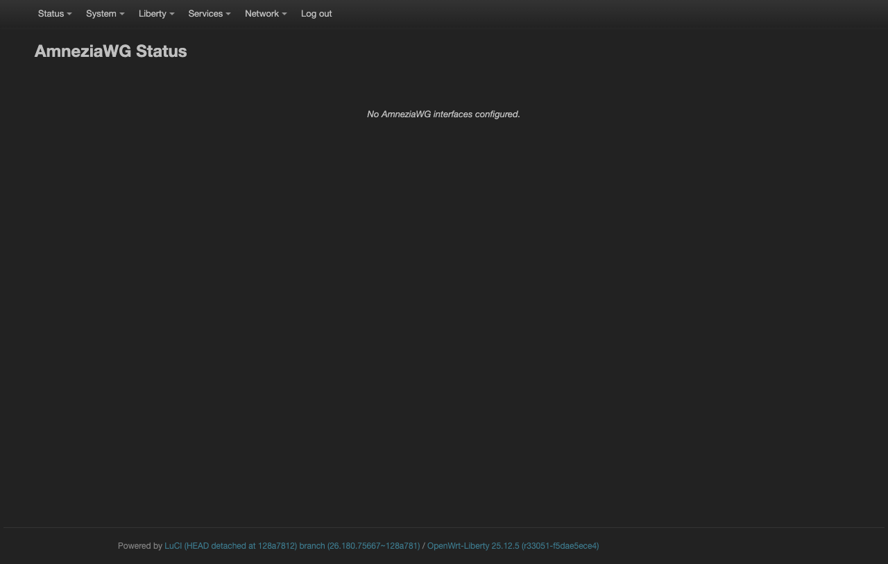
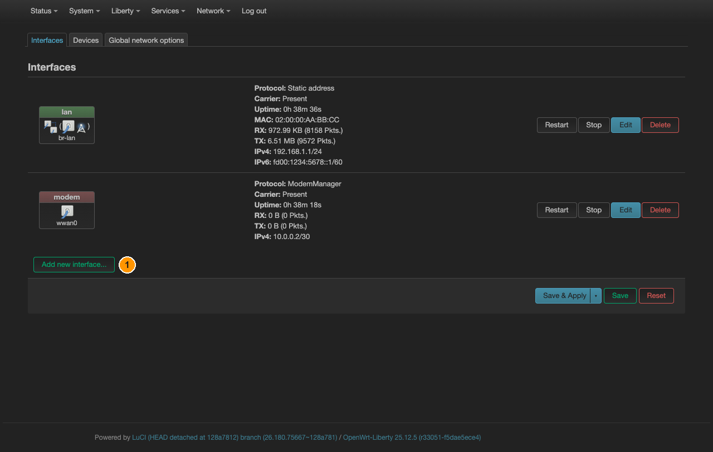

# AmneziaWG

[← All Liberty guides](README.md) · **English** · [Русский](amneziawg.ru.md)

WireGuard with obfuscation. The handshake and packet headers are padded and
reshaped so that a DPI box cannot recognise the protocol — useful where plain
WireGuard is detected and throttled or blocked. Everything else behaves exactly
like WireGuard.

The kernel module shipped in this firmware **matches the vermagic of the running
kernel**. A module downloaded from elsewhere will refuse to load.

## Where it lives

**Liberty → AmneziaWG** is a **status page only**:

Nothing is configured here. The connection itself is a network interface, so it is
created in **Network → Interfaces**. Once it exists, this page shows its peers,
handshakes and transfer counters.

## Step 1 — create the interface

**Network → Interfaces** lists what the dongle already has — `lan` (the bridge you
are managing it over) and `modem` (the 4G uplink). Leave both alone; the tunnel is
a third, separate interface.

*① **Add new interface…**, at the bottom of the list.*

*① **Name** — `awg0`. ② **Protocol** — **AmneziaWG VPN**. ③ **Create interface**.*

| Field | Value |
|---|---|
| Name | `awg0` |
| Protocol | **AmneziaWG VPN** |

**Create interface** opens the interface's own dialog straight away, and Steps 2–4
all happen inside it. If you closed it, get back with **Network → Interfaces** →
the `awg0` row → **Edit**.

## Step 2 — fill in the keys

In that dialog, tab **General Settings**:

- **Private Key** — yours, from the provider's configuration
- **Listen Port** — leave empty for a client
- **IP Addresses** — the address the provider assigned you, with its mask, e.g. `10.8.0.2/24`

## Step 3 — add the peer

Tab **Peers** → button **Add peer**. Another dialog opens:

| Field | Value | Note |
|---|---|---|
| Public Key | the server's public key | |
| Preshared Key | if the provider gave one | optional |
| **Allowed IPs** | `0.0.0.0/0` | **this is what sends all traffic into the tunnel** |
| Route Allowed IPs | **on** | creates the routes for the above |
| Endpoint Host / Port | the server's address and port | |
| Persistent Keep Alive | `25` | keeps the tunnel alive behind NAT |

`Allowed IPs = 0.0.0.0/0` is the setting that matters. Anything narrower sends only
those subnets through the tunnel and leaves the rest on the modem. Add `::/0` as
well if you use IPv6.

## Step 4 — the obfuscation parameters

Tab **AmneziaWG Settings** — this one, not *Advanced Settings*, which is the
generic netifd tab every interface has. It holds the AmneziaWG-specific fields:
**Jc**, **Jmin**, **Jmax**, **S1**–**S4**, **H1**–**H4** and **I1**–**I5**.

**They must match the server exactly.** They are not tuning knobs — they describe
the packet shape both ends agree on. One wrong value and the handshake never
completes, with no useful error: the interface simply stays silent. Copy them
verbatim from the provider's configuration.

Then **Save** to close the dialog, and **Save & Apply** at the bottom of the
Interfaces page.

## Step 5 — route everything through it, with no leaks

Follow [Never leak: kill-switch and DNS](kill-switch.md): create a `vpn` zone
covering `awg0`, and move the `lan` forwarding from `wan` to it. Start at Step 2
there — `awg0` is already an interface, so Step 1 does not apply.

`Allowed IPs = 0.0.0.0/0` alone is **not** a kill-switch. It sets the route while
the tunnel is up; when it drops, the route disappears and traffic falls back to the
modem. The firewall change is what prevents that.

## Verifying

**Liberty → AmneziaWG** shows the peer with a **Latest handshake** timestamp. A
handshake in the last two minutes means the tunnel is genuinely alive; transfer
counters alone can look plausible while nothing works.
