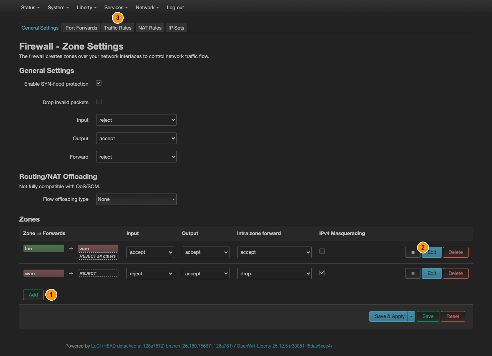

# Чтобы не текло: kill-switch и DNS

[← Все инструкции Liberty](README.ru.md) · [English](kill-switch.md) · **Русский**

Общая часть для **каждого приложения Liberty, которое несёт ваш трафик**, —
AmneziaWG, WireGuard, OpenVPN, Tailscale и PassWall. Сделайте это один раз, и
трафик ваших устройств не сможет уйти через модем ни на секунду: ни когда туннель
упал, ни пока он переподключается, ни до его подъёма после перезагрузки.

Форма немного отличается по приложениям, поэтому начните со своей строки:

| Приложение | Как выглядит kill-switch | Шаги |
|---|---|---|
| [AmneziaWG](amneziawg.ru.md), [WireGuard](wireguard.ru.md) | зона поверх интерфейса туннеля и `lan ⇒ vpn` вместо `lan ⇒ wan` | 2 → 3 → 4 |
| [OpenVPN](openvpn.ru.md) | то же самое, но его устройство `tun0` сперва надо обернуть в интерфейс | 1 → 2 → 3 → 4 |
| [Tailscale](tailscale.ru.md) | интерфейс, зону и `lan ⇒ tailscale` создаёт само приложение — вручную только убрать `lan ⇒ wan`, и **не** при выбранном exit node | [его шаг 4](tailscale.ru.md#шаг-4--kill-switch), затем 4 |
| [PassWall](passwall.ru.md) | `lan ⇒ wan` убирается, и на его место **ничего** не ставится: это прокси, а не маршрут | [его шаг 4](passwall.ru.md#шаг-4--kill-switch), затем 4 |
| [Zapret](zapret.ru.md) | никак — и никак невозможно | — |

Zapret здесь единственное исключение, и не по недосмотру: он не туннель. Ваш трафик
по замыслу идёт через модем, только изменённой формы, поэтому удаление forwarding'а
`lan ⇒ wan` ничего не защитит — оно просто отключит вас от сети.

**Шаг 4 нужен всем пятерым.** Маршрутизация и разрешение имён текут независимо друг
от друга, и закрытие одного не закрывает второе.

## Идея

OpenWrt не решает «через VPN или нет» для каждого пакета. Он объединяет интерфейсы в
**зоны** и разрешает трафик между ними **перенаправлениями**. Изначально оно ровно
одно:

```
lan  ⇒  wan
```

Именно поэтому ваши устройства выходят в интернет через модем. Kill-switch — это не
дополнительное правило, что-то запрещающее, а **отсутствие** этого перенаправления.
Направьте `lan` в зону туннеля вместо `wan` — и пути к модему для пересылаемого
трафика попросту не станет. Нечему ломаться, нечему успевать раньше.

Всё нижеследующее делается на одной странице: **Network → Firewall**, вкладка
**General Settings**. Исключение — правило DNS из шага 4: оно живёт на вкладке
**Traffic Rules** той же страницы.



*① **Add** — создаёт зону туннеля (шаг 2). ② **Edit** в строке **lan** — там
переносится перенаправление (шаг 3); плашка `⇒ wan` рядом с `lan` и есть это
перенаправление. ③ вкладка **Traffic Rules** — туда добавляется правило DNS из шага 4.*

## Шаг 1 — дать туннелю интерфейс

Для AmneziaWG и WireGuard шаг не нужен: они **сами** являются интерфейсами и
создаются в **Network → Interfaces**. Он нужен OpenVPN, который создаёт голое
устройство `tun0`, ничего не сообщая firewall, — см.
[инструкцию по OpenVPN](openvpn.ru.md#шаг-3--показать-туннель-системе).

Для Tailscale он тоже не нужен, но по обратной причине: голое устройство
`tailscale0` он создаёт, а потом **сам** заворачивает его в интерфейс и зону.
Обернуть второй раз руками — значит построить конкурирующий интерфейс поверх того
же устройства, см. [его шаг 4](tailscale.ru.md#шаг-4--kill-switch).

## Шаг 2 — создать зону для туннеля

**Network → Firewall**, вкладка **General Settings**, раздел **Zones**, кнопка
**Add** (① на скриншоте). Откроется диалог:

| Поле | Значение | Зачем |
|---|---|---|
| Name | `vpn` | любое имя, на него ссылается перенаправление ниже |
| Input | `reject` | из туннеля ничто не должно достучаться до самого роутера |
| Output | `accept` | роутер может отправлять в туннель |
| Forward | `reject` | пришедшее из туннеля дальше не пересылается |
| Masquerading | **включить** | дальняя сторона видит один адрес, а не вашу подсеть |
| MSS clamping | **включить** | без этого крупные пакеты молча пропадают — см. ниже |
| Covered networks | ваш интерфейс туннеля | `vpn`, `awg0`, `wg0` — как назвали |

Поля **Allow forward to destination zones** и **Allow forward from source zones**
здесь оставьте пустыми: нужное перенаправление создаётся следующим шагом. Нажмите
**Save**, чтобы закрыть диалог, — на устройство зона попадёт только после
**Save & Apply** внизу страницы.

> **MSS clamping — не опция.** У туннеля MTU меньше, чем у Ethernet. Без подгонки
> мелкие запросы проходят, а крупные передачи встают: страницы грузятся наполовину,
> загрузки замирают на нескольких килобайтах. Выглядит как сломанный VPN и
> диагностируется тяжело — включайте сразу.

## Шаг 3 — перевести перенаправление

Там же, в **Network → Firewall → General Settings → Zones**, нажмите **Edit** в
строке **lan** (② на скриншоте). В поле **Allow forward to destination zones**
выберите **vpn** и **уберите wan**. **Save**, затем **Save & Apply**.

Именно это и есть kill-switch. Не добавляйте `vpn`, оставив `wan`: при обоих трафик
свалится на модем в тот момент, когда туннель упадёт, и вы этого не заметите.

> **Из командной строки одного `uci commit` мало.** Изменение вступает в силу
> только после перезагрузки firewall: до неё в правилах по-прежнему стоит
> `jump accept_to_wan`, и трафик продолжает идти мимо туннеля, хотя
> `uci show firewall` выглядит правильно. После коммита выполните
> `/etc/init.d/firewall reload`. В LuCI кнопка **Save & Apply** делает это сама,
> поэтому шаги выше не затронуты.

## Шаг 4 — закрыть утечку DNS

Маршрутизация теперь герметична, а разрешение имён — нет. Резолвер самого роутера
обращается к DNS-серверам оператора через `wan`, причём от имени ваших устройств.
Адреса, которые вы посещаете, видны, хотя сам трафик — нет.

Имена утекают по двум разным путям, и закрытие одного не закрывает второй. Нужны
обе половины ниже.

### 4a — запретить роутеру спрашивать в открытую

**Уже сделано за вас.** Свежая прошивка приезжает с правилом, запрещающим
**самому роутеру** отправлять обычный DNS наружу через модем, и переводит оба
DoH-резолвера в адресную форму (`https://1.1.1.1/dns-query`,
`https://8.8.8.8/dns-query`), чтобы порт 53 не понадобился вообще. Одно без
другого не работает, и порядок здесь не произволен: `https-dns-proxy` разрешает
имя своего эндпоинта по 53 порту один раз при запуске, и правило, блокирующее
этот запрос, оставляет вас без DNS после каждой перезагрузки.

Проверить: **Network → Firewall**, вкладка **Traffic Rules** (③ на скриншоте),
правило с именем `Block-DNS-leak-via-wan`.

Если его нет — удалили руками или прошивка старее этой инструкции — нажмите
**Add** внизу списка правил и заполните диалог (а URL резолверов смените
заранее, в **Services → HTTPS DNS Proxy**):

| Поле | Значение |
|---|---|
| Name | `Block-DNS-leak-via-wan` |
| Protocol | **TCP** и **UDP** — у нового правила так и стоит по умолчанию |
| Source zone | **Device (output)** — эта запись и означает трафик самого роутера |
| Destination zone | `wan` |
| Destination port | `53 853` |
| Action | **reject** |

Поля адресов оставьте пустыми. **Save**, затем **Save & Apply**.

Из командной строки:

```sh
uci set firewall.dnsleakguard=rule
uci set firewall.dnsleakguard.name='Block-DNS-leak-via-wan'
uci set firewall.dnsleakguard.dest='wan'
uci set firewall.dnsleakguard.proto='tcp udp'
uci set firewall.dnsleakguard.dest_port='53 853'
uci set firewall.dnsleakguard.target='REJECT'
uci commit firewall && /etc/init.d/firewall reload
```

**Почему именно так, а не очевидное правило `lan ⇒ wan` на порт 53.** Запрет DNS
**со стороны LAN** не даёт ничего: роутер перехватывает порт 53 ещё в `prerouting`
и отвечает сам, поэтому запросы ваших устройств вообще не становятся форвардными
пакетами. Утекает **собственный** запрос роутера к upstream, его и надо
останавливать.

**Почему это ничего не ломает.** Пока туннель поднят, DNS обрабатывается внутри
него (или отдаётся прокси) и до цепочки output зоны `wan` не доходит — правило
не срабатывает. Как только туннель падает, резолвер, откатившийся на обычный DNS,
упирается в это правило и останавливается, вместо того чтобы тихо продолжаться.

> **Чего это правило не закрывает.** Оно закрывает plaintext DNS и DoT (порт
> 853). **DoH** оно не закрывает: тот идёт обычным HTTPS по порту 443 и от
> любого другого веб-запроса неотличим. Исключение ровно одно, и это описанная
> выше ловушка, а не польза: резолвер, ещё не разрешивший имя своего эндпоинта,
> этим правилом останавливается и таким и остаётся. А уже работающий продолжает
> отвечать по 443, что бы ни случилось с туннелем, и правило не увидит ни одного
> его пакета. Для этого нужен шаг 4b.
>
> Своё место правило всё равно оправдывает: именно оно ловит `dnsmasq`, если
> `https-dns-proxy` окажется остановлен, — тогда `dnsmasq` сваливается на
> резолвер оператора, и имена идут **в открытую**. Поэтому не «упрощайте» схему
> отключением `https-dns-proxy`: станет хуже, а не лучше.

### 4b — чтобы шифрованный DNS умирал вместе с туннелем

`https-dns-proxy` продолжает отвечать, что бы ни случилось с вашим туннелем.
Обычный DNS ему для старта не нужен вовсе: адреса резолверов передаются прямо в
аргументах командной строки (`-b 1.1.1.1,1.0.0.1`), поэтому HTTPS-сессию он
открывает, ничего предварительно не разрешая. Kill-switch до него тоже не
дотягивается — это собственные пакеты роутера, а не форвардные. Остановите
туннель, и ваши устройства продолжат разрешать имена с настоящего адреса
роутера: *содержимое* трафика защищено, *список имён, которые вы посещаете* — нет.

Решение — привязать резолвер к тому, что несёт ваш трафик, тогда он откажет
вместе с ним.

**Для туннелей — AmneziaWG, WireGuard, OpenVPN, Tailscale — это происходит
само.** Прошивка отслеживает подъём туннельных интерфейсов и привязывает
исходящий сокет резолвера к адресу этого туннеля. Упал туннель — исчез адрес,
сокет не привязывается, любой запрос отказывает. При следующем подключении
привязка восстанавливается сама, на тот адрес, который туннель получит тогда.
Настраивать нечего; посмотреть, как это отработало, можно через
`logread | grep dns-bind-tunnel`.

**Для PassWall это делается один раз руками.** Его аналог — пустить резолвер
через сам прокси, и по умолчанию такого не заведёшь: на устройстве без PassWall
это направило бы резолвер на порт, за которым никого нет, и оставило совсем без
DNS.

Сначала включите socks-слушатель — **Liberty → PassWall → Basic Settings →
Main**, поле **TCP Node Socks Listen Port** (по умолчанию 1070), оставив **Bind
Local** включённым. Затем **Services → HTTPS DNS Proxy**, поле **Proxy Server**:

```
socks5://127.0.0.1:1070
```

или из командной строки:

```sh
uci set https-dns-proxy.config.proxy_server='socks5://127.0.0.1:1070'
uci commit https-dns-proxy && /etc/init.d/https-dns-proxy restart
```

Когда PassWall остановлен, на этом порту никого нет, и разрешение имён
прекращается вместе с ним.

В обоих случаях демон продолжает работать и просто перестаёт получать ответы.
Идти `dnsmasq` больше некуда, поэтому разрешение имён отказывает наглухо, а не
откатывается на что-нибудь похуже.

## Шаг 5 — убедиться, что держит

Не верьте настройке, проверьте её:

1. При поднятом туннеле убедитесь, что внешний адрес — туннельный.
2. **Остановите туннель**: **Network → Interfaces → Stop** для AmneziaWG и
   WireGuard; **Liberty → OpenVPN → stop** для OpenVPN; для Tailscale —
   **Liberty → Tailscale → Global Settings → Basic Settings**, снять **Enable**;
   для PassWall — **Liberty → PassWall → Basic Settings → Main**, снять
   **Main switch**.
3. С устройства за донглом откройте любой сайт. Он **не должен** открыться. Если
   что-то грузится — перенаправление `lan ⇒ wan` осталось на месте.
4. Не поднимая туннель, разрешите имя, которого вы никогда не посещали:
   `nslookup www.videolan.org` с того же устройства. Оно тоже **не должно**
   разрешиться. Если ответ пришёл — не сделан шаг 4b: маршрутизация закрыта, а
   имена, которые вы запрашиваете, по-прежнему уходят наружу.
5. Запустите обратно и убедитесь, что доступ вернулся.

## Что остаётся разрешённым намеренно

У **самого роутера** доступ в `wan` сохраняется. Иначе и нельзя: именно так
VPN-клиент достукивается до своего сервера. Шаги выше меняют судьбу только
**пересылаемых** пакетов — тех, что идут от ваших устройств. Это правильное
поведение, а не утечка.
