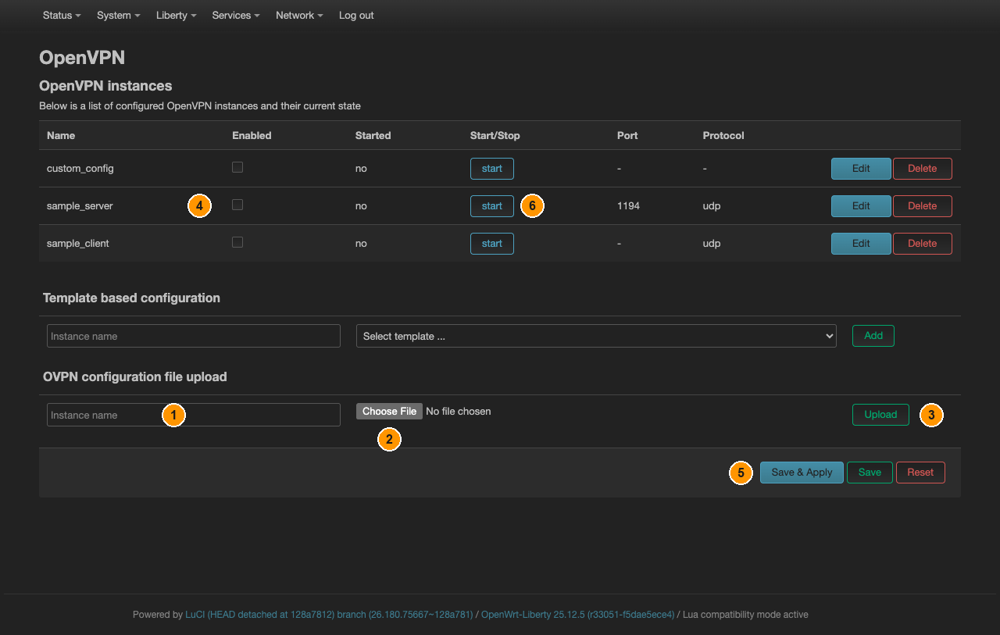

# OpenVPN

[← Все инструкции Liberty](README.ru.md) · [English](openvpn.md) · **Русский**

Классический VPN-клиент. OpenWrt запускает его как службу, которая создаёт
устройство `tun0`; firewall об этом устройстве нужно сообщить отдельно — именно этот
шаг обычно и пропускают.

## Шаг 1 — загрузить конфигурацию провайдера

**Liberty → OpenVPN**, раздел **OVPN configuration file upload** внизу страницы.



*Шаг 1: ① **Instance name** — имя подключения. ② **Choose File** — ваш `.ovpn`.
③ **Upload**. Шаг 2: ④ **Enabled** в новой строке, ⑤ **Save & Apply**, ⑥ **start**.*

Подключение появится в списке выше со снятой галочкой **Enabled**.

Если провайдер выдал сертификаты отдельными файлами, а не одним `.ovpn`, положите их
в `/etc/openvpn/` и укажите путями. Раздел **Template based configuration** чуть выше
формы загрузки создаёт заготовку, которую потом можно править по полям.

## Шаг 2 — запустить и убедиться, что туннель поднялся

На той же странице: поставьте галочку **Enabled** в строке подключения, нажмите
**Save & Apply**, затем **start** в столбце **Start/Stop**.

В столбце **Started** появится `yes` с номером процесса. Это означает лишь, что
служба работает, — но не что туннель установлен. Откройте **Status → System Log** и
найдите `Initialization Sequence Completed`. Два сообщения говорят, что не вышло:

- `Network unreachable` — у донгла вообще нет интернета. Сначала чините модем,
  OpenVPN тут ни при чём.
- `TLS handshake failed` — сервер доступен, но отвергает подключение: не те
  сертификаты, неверное время на донгле или провайдер блокирует.

## Шаг 3 — показать туннель системе

`tun0` OpenVPN создаёт сам, но netifd о нём не знает, и ни одна зона firewall на него
сослаться не может. Создайте интерфейс-обёртку над готовым устройством:

**Network → Interfaces**, кнопка **Add new interface…** внизу списка.


*① **Name** — `vpn`. ② **Protocol** — **Unmanaged**; после его выбора ниже
появляется поле **Device** (на скриншоте выбран другой протокол).
③ **Create interface**.*

| Поле | Значение |
|---|---|
| Name | `vpn` |
| Protocol | **Unmanaged** |
| Device | `tun0` |

Нажмите **Create interface**, затем **Save** в открывшемся диалоге. Зону firewall в
нём не назначайте — это делается следующим шагом осознанно.

> **Из командной строки интерфейс надо ещё и поднять.** Записать секцию через
> `uci` и закоммитить недостаточно: пока не выполнены `/etc/init.d/network
> reload` **и** `ifup vpn`, netifd её не регистрирует, и `tun0` не попадает
> **ни в одну зону firewall** — зона пуста, форвардный трафик до туннеля не
> доходит. Коварство в том, что **собственный** трафик роутера при этом
> работает, и туннель выглядит исправным. В LuCI кнопка **Create interface**
> делает этот шаг сама.

> **Unmanaged** здесь правильный выбор: адресами и маршрутами устройства управляет
> OpenVPN, а не netifd. Интерфейс нужен исключительно затем, чтобы firewall было на
> что ссылаться.

## Шаг 4 — пустить всё через туннель без утечек

Дальше по инструкции [Чтобы не текло: kill-switch и DNS](kill-switch.ru.md):
создайте зону `vpn` с этим интерфейсом и переведите перенаправление `lan` с `wan` на
`vpn`. Шаг 1 там — это интерфейс, который вы только что создали, так что продолжайте
с шага 2.

## Шаг 5 — проверить маршрут по умолчанию

Большинство провайдеров отдают с сервера `redirect-gateway def1`, и тогда после
подъёма туннеля всё уже идёт через него. Проверить проще всего с устройства за
донглом: изменился ли внешний адрес.

Если не изменился — сервер маршрут по умолчанию не отдаёт, и его прописывают сами.
**Liberty → OpenVPN → Edit** в строке подключения ведёт на одну из двух разных
страниц, смотря как это подключение появилось:

- **Загруженный `.ovpn`** — **Edit** открывает сам файл текстом. Добавьте строку
  `redirect-gateway def1`, нажмите **Save** и перезапустите подключение
  (**stop**, **start**).
- **Из шаблона или руками** — **Edit** открывает форму. Перейдите по ссылке
  **Switch to advanced configuration »** вверху, затем **Configuration category:
  VPN**, и задайте **Automatically redirect default route** = `def1`.
  **Save & Apply** и перезапуск подключения.

> **Если туннель поднят, а адрес всё равно не изменился — маршруты вычищаются.**
> Интерфейс из шага 3 передаёт `tun0` под управление netifd, а тот удаляет
> маршруты, которые поставил сам OpenVPN. Измерено на этой прошивке: обе половины
> `def1` — `0.0.0.0/1` и `128.0.0.0/1` — появляются при подключении OpenVPN и
> исчезают в момент подъёма интерфейса. Трафик после этого идёт через модем, и
> со стороны это неотличимо от работающего подключения, пока не проверишь адрес.
> С настроенным kill-switch утечки не будет, но и интернета тоже.
>
> Решение — отдать маршруты netifd, тогда они принадлежат интерфейсу и
> возвращаются вместе с ним. **Network → Routing**, раздел **Static IPv4
> Routes**, **Add** — дважды, оба на интерфейс `vpn`, в **Gateway** — адрес
> дальнего конца туннеля (peer-адрес, который OpenVPN показывает у `tun0`):
>
> | Target | Netmask |
> |---|---|
> | `0.0.0.0` | `128.0.0.0` |
> | `128.0.0.0` | `128.0.0.0` |
>
> **Save & Apply**. Из командной строки:
>
> ```sh
> uci set network.vpnr1=route
> uci set network.vpnr1.interface='vpn'
> uci set network.vpnr1.target='0.0.0.0'
> uci set network.vpnr1.netmask='128.0.0.0'
> uci set network.vpnr1.gateway='10.8.0.1'   # дальний конец вашего туннеля
> uci set network.vpnr2=route
> uci set network.vpnr2.interface='vpn'
> uci set network.vpnr2.target='128.0.0.0'
> uci set network.vpnr2.netmask='128.0.0.0'
> uci set network.vpnr2.gateway='10.8.0.1'
> uci commit network && /etc/init.d/network reload && ifup vpn
> ```
>
> Именно два маршрута `/1`, а не один default: они выигрывают у маршрута через
> модем, не заменяя его, поэтому клиент OpenVPN сохраняет собственный путь до
> сервера.

## Известная особенность этой прошивки

На страницах-формах кнопка выбора файла рядом с путями к сертификатам и ключам ведёт
на несуществующую страницу: в LuCI убрали старый файловый браузер CBI, а приложение
OpenVPN на него по-прежнему ссылается. Вписывайте путь вручную — само поле работает
нормально.
