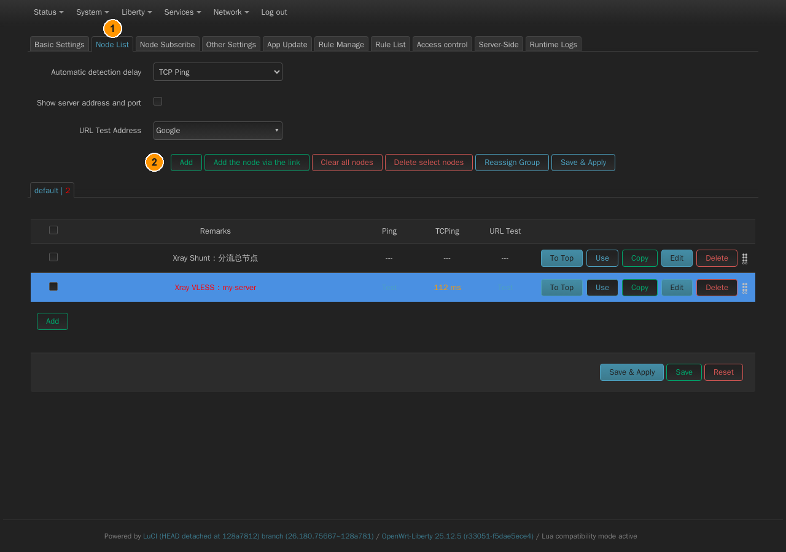
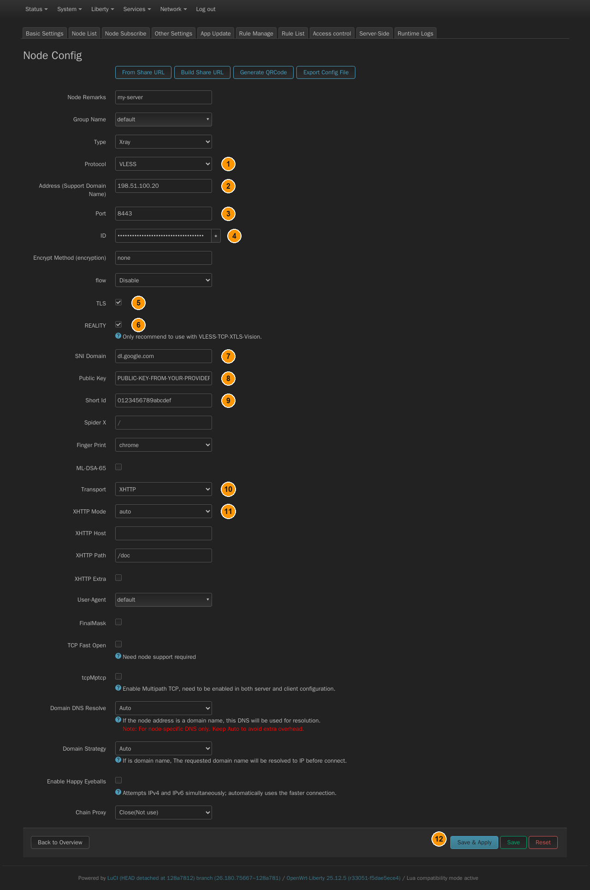
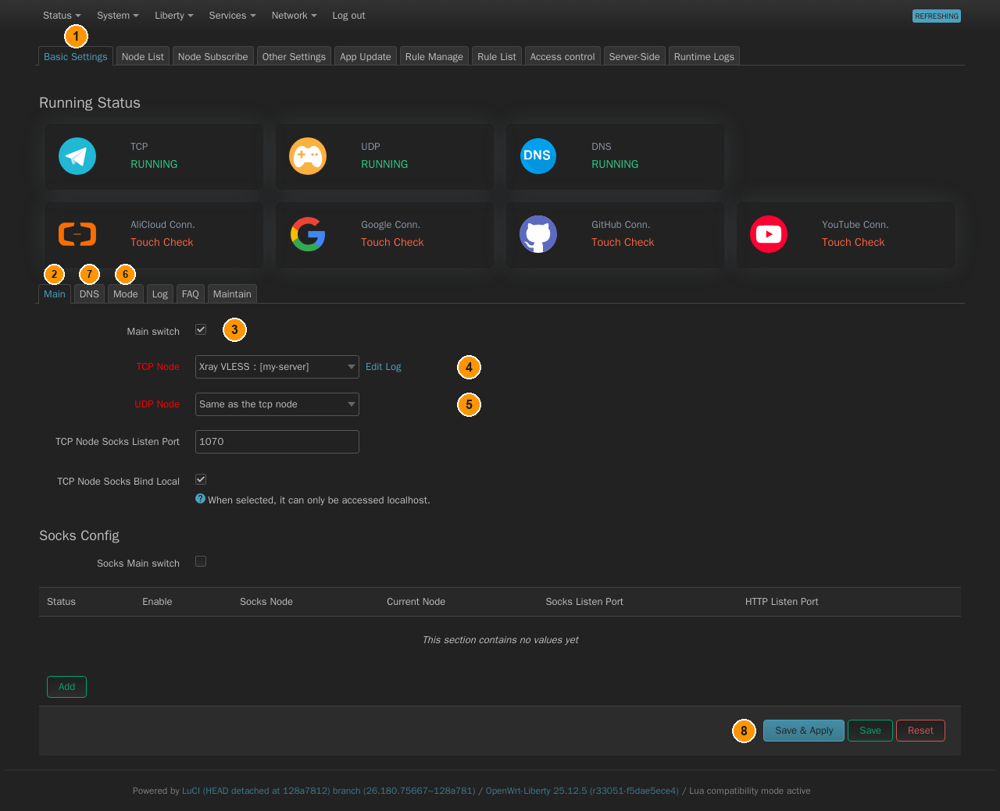

# PassWall

[← All Liberty guides](README.md) · **English** · [Русский](passwall.ru.md)

A LuCI front end for **xray-core** — the way to use modern transports such as VLESS,
Reality and XHTTP, which look like ordinary HTTPS to an observer.

PassWall does **not** work like the tunnels. It never becomes a route: instead it
installs nftables rules that intercept outgoing connections and hand them to
xray-core, which opens its own connection to your server. That difference changes
what "all traffic" means here — but it does **not** exempt you from the
kill-switch, which works for PassWall too (Step 4).

## Step 1 — add a node

**Liberty → PassWall**, tab **Node List**, button **Add**.

*① the **Node List** tab. ② **Add** — opens the **Node Config** page below. The
**Add the node via the link** button next to it imports a share link instead.*

**Add** opens a page called **Node Config**. Fill in what your provider gave you:
remarks, address, port, protocol — **VLESS** is what carries Reality and XHTTP —
and UUID (the field is labelled **ID**). Ticking **TLS** and then **REALITY**
reveals the Reality-specific fields:

- **Public Key**, **Short Id** and **Spider X** (leave Spider X as `/` unless your
  provider says otherwise) come from whoever runs the Reality server, not from you.
- **SNI Domain** must be the handshake target the *server* was configured with.
  Not every site works as one, and a wrong choice fails in a way that looks like
  a key problem: the server logs `REALITY: processed invalid connection:
  handshake did not complete successfully` while your keys are perfectly fine.
  `dl.google.com` works as one; `www.microsoft.com` does not, even though it is
  reachable, speaks TLS 1.3 and h2 and serves a valid certificate. If the
  handshake fails and the keys are definitely right, suspect this field first.
- **Finger Print** picks which browser's TLS handshake xray-core imitates (`chrome`
  by default) — leave it unless told otherwise.
- A newer Reality variant adds an **ML-DSA-65** post-quantum verification key — only
  fill it in if your provider issued one.

**Transport** → **XHTTP** exposes **Mode** (`auto` / `packet-up` / `stream-up` /
`stream-one` — `auto` is the sane default), **Host** and **Path**. An **XHTTP Extra**
JSON field is available for advanced per-mode options (upload limits, padding…) if
your provider requires them — most setups do not need it.

*The **Node Config** page, in order: ① **Protocol** = `VLESS`. ② **Address**.
③ **Port**. ④ **ID** (the UUID). ⑤ **TLS** on. ⑥ **REALITY** on — this is what makes
⑦–⑨ appear. ⑦ **SNI Domain**. ⑧ **Public Key**. ⑨ **Short Id**. ⑩ **Transport** =
`XHTTP` — this makes **XHTTP Mode / Host / Path** appear. ⑪ **XHTTP Mode**.
⑫ **Save & Apply**. The fields not numbered can keep their defaults.*

A subscription can be imported instead of typing a node by hand: tab
**Node Subscribe**.

## Step 2 — point the client at it

**Liberty → PassWall**, tab **Basic Settings**, sub-tab **Main** (the second row of
tabs, below the status tiles):

*① the **Basic Settings** tab. ② sub-tab **Main**. ③ **Main switch**. ④ **TCP Node**.
⑤ **UDP Node**. ⑥ sub-tab **Mode** — the second table below. ⑦ sub-tab **DNS** —
Step 3. ⑧ **Save & Apply**, after each change.*

| Field | Set to | Why |
|---|---|---|
| **Main switch** | on | PassWall is disabled by default — nothing happens until you turn it on |
| **TCP Node** | your node | `Close` by default |
| **UDP Node** | `Same as the tcp node` | otherwise UDP, including QUIC, bypasses the proxy |

Sub-tab **Mode** — same row of tabs — is where "how much goes through it" is
actually decided, and the defaults are not "all traffic":

| Field | Set to | Why |
|---|---|---|
| **China List** | `Close(Not use)` or `Proxy` | default is `Direct Connection` — sends a whole rule list around the proxy |
| **TCP/UDP Default Proxy Mode** | `Proxy` | already the default, but check it — `No Proxy` disables interception entirely |
| **Client Proxy** | on | already the default, but check it — it is what lets **LAN devices**, not just the router itself, be transparently proxied; only offered if the tproxy/redirect kernel modules are loaded, which they are on this firmware |

**This is "all traffic":** China List not routing anything around the proxy, both
Default Proxy Modes on `Proxy`, Client Proxy on. Need per-device exceptions instead
of all-or-nothing? The top-level tab **Access control** lets specific devices use a
different mode, port or node.

Press **Save & Apply** at the bottom of the page.

## Step 3 — DNS

DNS matters more here than with a tunnel. If names are resolved through the modem,
the operator sees every host you visit even though the connections themselves are
proxied — and worse, you may be sent to a blocked address that then fails.

**Liberty → PassWall → Basic Settings**, sub-tab **DNS** configures the resolver
PassWall itself shunts through; point it at a resolver reached *through* the proxy,
not the modem's own.

## Step 4 — the kill-switch

**Do this. Without it, the moment xray-core stops your devices go back to the
modem in the clear, and nothing tells you.**

The [kill-switch guide](kill-switch.md) says the trick is the *absence* of the
`lan ⇒ wan` forwarding. That applies here too — the only difference is that a proxy
has no tunnel zone to point `lan` at instead. So you remove the forwarding and put
nothing in its place:

**Network → Firewall**, tab **General Settings**, section **Zones**, button **Edit**
on the **lan** row. Clear **Allow forward to destination zones** entirely, press
**Save**, then **Save & Apply** at the bottom of the page.

That is the whole change. Your devices now have no route out except through the
router itself.

> **Why proxied traffic still works.** PassWall does not forward your packets —
> it *intercepts* them. Its nftables rules sit in `prerouting` and redirect each
> connection to xray-core listening on the router, so the packet is delivered
> locally and never reaches the forward chain at all. xray-core then opens its
> own connection outward, and that is the *router's* traffic, which is still
> allowed. Remove the forwarding and the proxy keeps working; only unproxied
> traffic loses its way out — which is exactly the point.

When xray-core dies, its redirect rules disappear with it. Your devices' packets
then become ordinary forwarded packets — and with no `lan ⇒ wan` forwarding they
hit the firewall's default `drop`. Traffic stops instead of leaking.

### Verify it actually holds

Do not trust the configuration, verify it:

1. With PassWall running, open any site from a device behind the dongle.
2. **Liberty → PassWall → Basic Settings → Main**: clear the **Main switch** and
   press **Save & Apply**.
3. Open any site again. It must fail. If anything loads, the `lan ⇒ wan`
   forwarding is still there.
4. Turn the **Main switch** back on and confirm traffic returns.

> **The router itself keeps its access to `wan`.** It has to: that is how
> xray-core reaches your server. Only *forwarded* packets — the ones from your
> devices — are affected. This is the correct behaviour, not a leak, and it is
> the same rule as for the routed tunnels.

> **DNS needs one more rule — do not skip it.** Removing the forwarding stops
> TCP and UDP, but *name resolution* survives on its own: the router intercepts
> port 53 before the forward chain and keeps resolving upstream even after
> xray-core is gone. Add the DNS rule from
> [Step 4 of the kill-switch guide](kill-switch.md#step-4--close-the-dns-leak) —
> one traffic rule that forbids the router's own DNS through `wan`. With it in
> place, name resolution stops together with the proxy.

## Verifying

**Liberty → PassWall → Basic Settings → Main** shows node status at a glance in the
**Running Status** tiles above the tabs; **Liberty → PassWall → Runtime Logs** shows
xray-core's own log. Then check from a device behind the dongle that your public
address is the server's — status and logs alone do not prove traffic is actually
being proxied.
