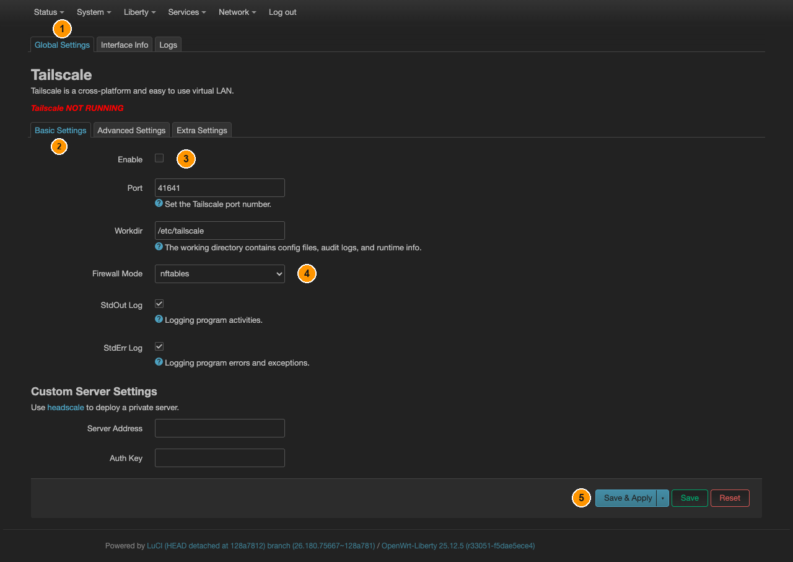
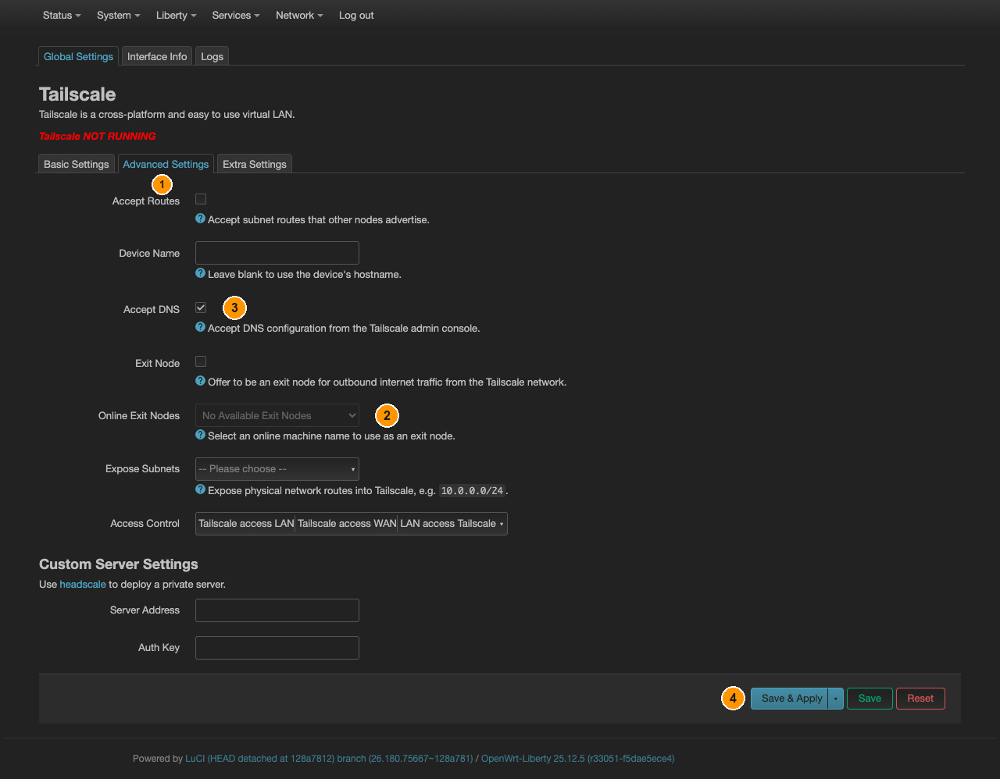
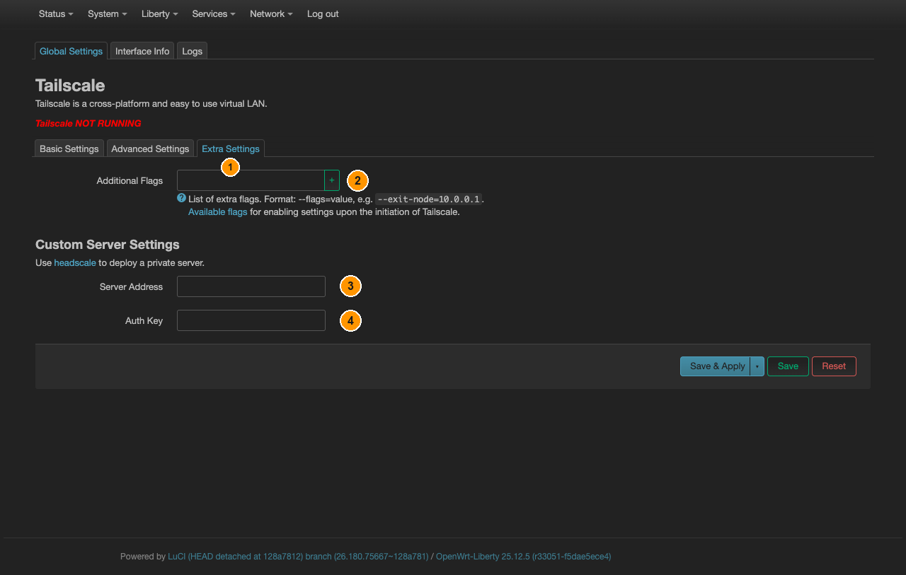

# Tailscale

[← Все инструкции Liberty](README.ru.md) · [English](tailscale.md) · **Русский**

Mesh-VPN между **вашими собственными** машинами. Заведите все устройства в одну
учётную запись — и они увидят друг друга напрямую, где бы ни находились, без проброса
портов и без белого адреса.

Сам по себе он **не** уводит куда-либо ваш интернет-трафик, а связывает ваши
устройства между собой. Трафик пойдёт через Tailscale только если одна из машин
назначена **выходным узлом**, а донглу велено ею пользоваться.

## Шаг 1 — включить

**Liberty → Tailscale**, вкладка **Global Settings**, подвкладка **Basic Settings**:

*① вкладка **Global Settings**. ② подвкладка **Basic Settings**. ③ **Enable**.
④ **Firewall Mode** — оставить `nftables`. ⑤ **Save & Apply**. Поле **Auth Key**
внизу относится к **Custom Server Settings** — прочитайте шаг 2, прежде чем им
пользоваться.*

Поставьте **Enable** и нажмите **Save & Apply**. Остальные поля можно не трогать:
порт `41641` и рабочий каталог `/etc/tailscale` по умолчанию подходят, а **Firewall
Mode** должен остаться `nftables` — этот OpenWrt использует именно их.

## Шаг 2 — войти в учётную запись

**Интерактивно** — способ, который работает всегда: ключ не трогайте, откройте
**Liberty → Tailscale**, вкладка **Logs**. `tailscaled` напечатает там ссылку для
входа. Откройте её в браузере и подтвердите устройство.

> **Поле Auth Key на странице настроек в этой прошивке не работает.** Оно относится
> к **Custom Server Settings**, и его значение не доходит до `tailscale up`:
> страница LuCI пишет опцию как `authKey`, а init-скрипт читает `authkey`, тогда
> как имена опций UCI регистрозависимы. Ключ будто бы сохраняется и не делает
> ничего. Это дефект самого `luci-app-tailscale`, а не ваша ошибка в настройке.
>
> Если регистрироваться хочется ключом, а не через браузер, впишите его в
> **Global Settings → Extra Settings → Additional Flags** как
> `--authkey=tskey-auth-…`: это поле читается правильно и передаётся прямо в
> `tailscale up`. Из командной строки работает и
> `uci set tailscale.settings.authkey='…'` (в нижнем регистре).

После этого **Login Status** на странице настроек покажет устройство подключённым.

## Шаг 3 — пустить весь трафик через выходной узел

Та же страница, подвкладка **Advanced Settings**:

*① подвкладка **Advanced Settings**. ② **Online Exit Nodes** — та самая настройка
«всё через Tailscale». ③ **Accept DNS** — включать вместе с ②. ④ **Save & Apply**.*

| Поле | Что делает |
|---|---|
| **Online Exit Nodes** | выбрать машину, через которую пойдёт **весь** интернет-трафик — это и есть «всё через Tailscale» |
| **Exit Node** | предложить *сам донгл* как выходной узел для ваших других машин — обратное направление |
| **Accept Routes** | принимать подсети, объявленные другими узлами |
| **Accept DNS** | брать настройки DNS из панели Tailscale |
| **Expose Subnets** | объявить локальную сеть донгла в вашей mesh-сети |
| **Access Control** | `Tailscale access LAN` / `Tailscale access WAN` / `LAN access Tailscale` |

Список показывает `No Available Exit Nodes`, пока хотя бы одна машина в вашей учётной
записи не объявит себя выходным узлом — включите это на самой машине и обновите
страницу.

Вместе с выходным узлом включайте и **Accept DNS**, иначе имена продолжат
разрешаться через модем, тогда как сам трафик пойдёт в другую сторону.

## Extra Settings — флаги и свой сервер

Та же страница, подвкладка **Extra Settings**: здесь лежит то, под что на остальных
вкладках нет полей:

*① подвкладка **Extra Settings**. ② **Additional Flags** — по одному флагу на
запись, зелёная **+** добавляет следующую. ③ **Server Address** и ④ **Auth Key** из
**Custom Server Settings** — это для своего headscale; для обычного Tailscale оба
оставьте пустыми.*

- **Additional Flags** — всё, что понимает `tailscale up`, но для чего нет
  отдельной галочки: по одному флагу на запись, в виде `--flag=value` (пример в
  самом поле — `--exit-node=10.0.0.1`). Пользуйтесь этим только для того, чего нет
  на вкладках Basic и Advanced: флаг отсюда и галочка оттуда могут противоречить
  друг другу.
- **Custom Server Settings** — поля **Server Address** и **Auth Key** направляют
  донгл на свой сервер [headscale](https://github.com/juanfont/headscale) вместо
  серверов Tailscale. Для обычного Tailscale оставьте оба пустыми. Этот блок
  показан на каждой подвкладке, поэтому те же два поля видны и в Basic Settings —
  это одна и та же настройка, а не две разные. Про дефект поля **Auth Key**
  написано в шаге 2.

## Шаг 4 — kill-switch

**Не делайте обёртку и зону руками.** В отличие от OpenVPN, Tailscale по
**Save & Apply** создаёт всё это сам: интерфейс `tailscale` поверх `tailscale0`,
одноимённую зону firewall с уже включёнными маскарадом и MSS clamping и
перенаправления, заданные полем **Access Control**, — включая `lan ⇒ tailscale`.
Второй интерфейс и вторая зона поверх того же устройства будут только
конкурировать с ними.

За вами — вторая половина:

1. **Network → Firewall → General Settings → Zones**, **Edit** в строке **lan**,
   и в **Allow forward to destination zones** уберите **wan**. `tailscale`
   оставьте — его добавило приложение. **Save**, затем **Save & Apply**.
2. Добавьте правило DNS из
   [шага 4 инструкции про kill-switch](kill-switch.ru.md#шаг-4--закрыть-утечку-dns) —
   **Network → Firewall → Traffic Rules → Add**. Без него разрешение имён
   переживает падение туннеля.

Правки firewall всегда доводите до **Save & Apply**. При любой ошибке своего
вспомогательного скрипта Tailscale откатывает все *незакоммиченные* изменения
`network`, `firewall` и `dhcp` — то, что осталось просто сохранённым, может
исчезнуть у вас под руками.

> **Пользуетесь выходным узлом? Тогда пункт 1 пропустите — сервис перестанет
> запускаться.** При выбранном выходном узле приложение само выключает
> `lan ⇒ wan`, а для этого ему надо сперва его *найти*. Если вы перенаправление
> уже убрали, поиск возвращает пустоту, скрипт считает это ошибкой и откатывает
> изменения вместе с остановкой сервиса — по кругу, пока procd не сдастся.
> Выберите одно: либо вы убираете `lan ⇒ wan` сами для режима сети между своими
> машинами, либо выбираете выходной узел и это делает приложение. Не оба сразу.

Сам роутер сохраняет доступ в `wan`, и это осознанно: именно так `tailscaled`
дотягивается до координационного сервера.

> **Что защищено в каком режиме.** Без выходного узла Tailscale — сеть между
> вашими собственными машинами: kill-switch выше работает, но интернет-трафик
> через Tailscale и не идёт, защищать почти нечего. С выходным узлом идёт — но
> тогда kill-switch остаётся на стороне приложения, а он fail-open: остановка
> Tailscale возвращает `lan ⇒ wan` **обратно**, ровно в тот момент, когда он был
> нужен убранным. Описанными шагами fail-closed «весь трафик через Tailscale» не
> получается ни в одном из режимов.

## Проверка

**Liberty → Tailscale**, вкладка **Interface Info** показывает интерфейс
`tailscale0` и выданные ему адреса. При выбранном выходном узле проверьте внешний
адрес с устройства за донглом — он должен принадлежать этому узлу.
