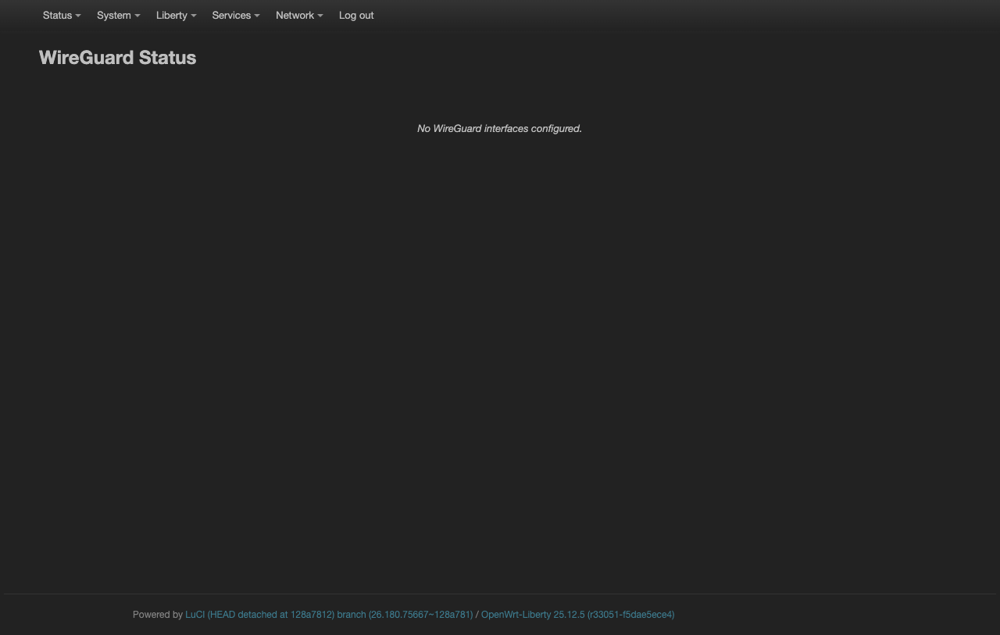
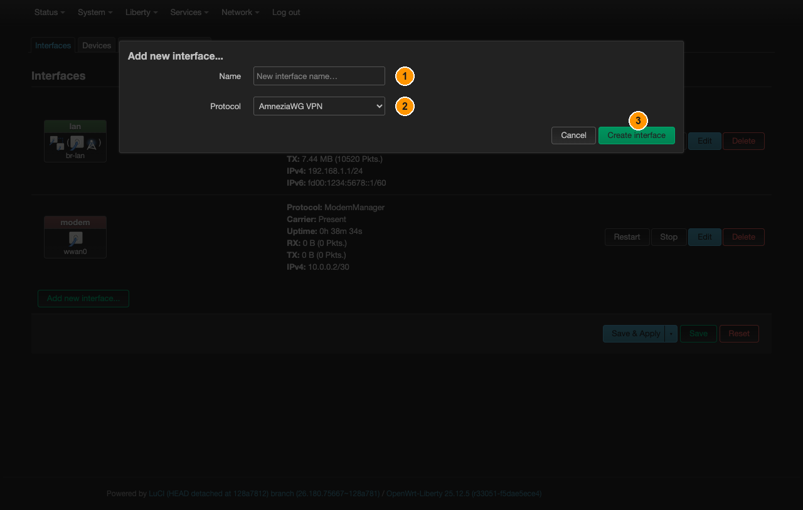

# WireGuard

[← All Liberty guides](README.md) · **English** · [Русский](wireguard.ru.md)

Standard WireGuard. Fast, small, and recognisable on the wire — a DPI box can
identify it easily. Where that is a problem, use [AmneziaWG](amneziawg.md) instead:
same configuration plus obfuscation.

## Where it lives

**Liberty → WireGuard** is a **status page only**:

Nothing is configured here. The connection is a network interface, created in
**Network → Interfaces**.

## Step 1 — create the interface

**Network → Interfaces**, button **Add new interface…** at the bottom of the list.

*① **Name** — `wg0`. ② **Protocol** — **WireGuard VPN**. ③ **Create interface**.*

| Field | Value |
|---|---|
| Name | `wg0` |
| Protocol | **WireGuard VPN** |

**Create interface** opens the interface's own dialog straight away, and Steps 2–3
happen inside it. If you closed it, get back with **Network → Interfaces** → the
`wg0` row → **Edit**.

## Step 2 — fill in the keys

In that dialog, tab **General Settings**:

- **Private Key** — yours
- **Listen Port** — leave empty for a client
- **IP Addresses** — the address the provider assigned you, e.g. `10.0.0.2/24`

There is a **Generate new key pair** button next to the private key if you are
setting up your own server and need a fresh pair.

## Step 3 — add the peer

Tab **Peers** → button **Add peer**. Another dialog opens:

| Field | Value | Note |
|---|---|---|
| Public Key | the server's public key | |
| Preshared Key | if used | optional |
| **Allowed IPs** | `0.0.0.0/0` | **this is what sends all traffic into the tunnel** |
| Route Allowed IPs | **on** | creates the routes for the above |
| Endpoint Host / Port | the server's address and port | |
| Persistent Keep Alive | `25` | keeps the tunnel alive behind NAT |

Add `::/0` too if you use IPv6.

Then **Save** to close the dialog, and **Save & Apply** at the bottom of the
Interfaces page.

## Step 4 — route everything through it, with no leaks

Follow [Never leak: kill-switch and DNS](kill-switch.md): create a `vpn` zone
covering `wg0`, and move the `lan` forwarding from `wan` to it. Start at Step 2
there — `wg0` is already an interface, so Step 1 does not apply.

`Allowed IPs = 0.0.0.0/0` is a routing statement, not a guarantee. It applies while
the interface is up; when the tunnel drops, the route goes with it and traffic
returns to the modem unless the firewall forbids that path.

## Verifying

**Liberty → WireGuard** lists each peer with its **Latest handshake**. WireGuard is
silent by design: no handshake means no tunnel, regardless of what the interface
status says.

A common failure with no visible error is a clock problem — WireGuard rejects
handshakes when the two ends disagree about time. The dongle has no battery-backed
clock, so if it has been offline it may start with a wrong date. Check
**Status → Overview**.
