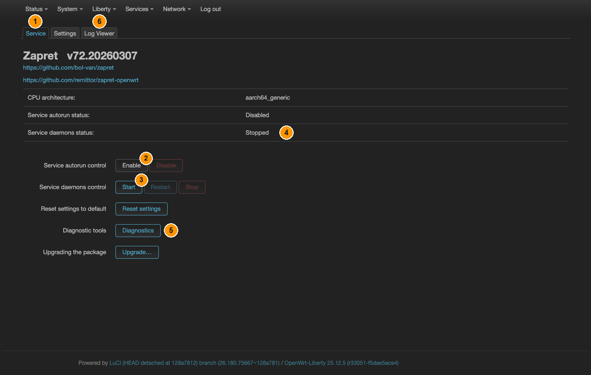
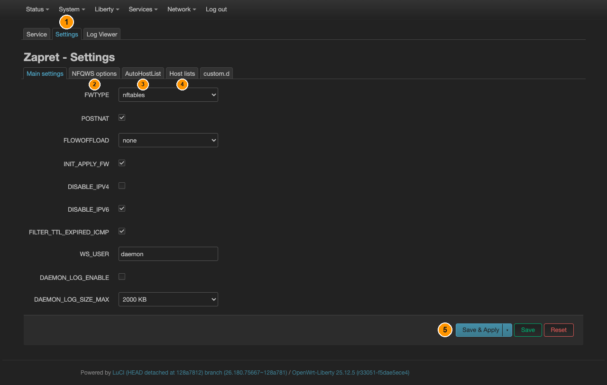

# Zapret

[← Все инструкции Liberty](README.ru.md) · [English](zapret.md) · **Русский**

Обход DPI **вообще без сервера**. Ничего не нужно арендовать, нигде не нужно
регистрироваться, удалённой точки нет — но по той же причине он ничего и не скрывает:
трафик по-прежнему идёт через модем с вашего собственного адреса.

## Что он делает на самом деле

Оборудование DPI определяет, что за соединение перед ним, по первым пакетам — прежде
всего по рукопожатию TLS, где имя сайта передаётся открытым текстом. Zapret
переписывает эти пакеты в момент отправки: разбивает, меняет порядок, правит TTL,
подсовывает обманки. До сервера части доходят, и он собирает их как обычно, а
проверяющая коробка посередине уже не узнаёт знакомый образец и пропускает.

Поэтому **«пустить весь трафик через Zapret» ничего не означает**. Это не туннель и
не прокси, никуда ничего не маршрутизируется. Он работает с теми соединениями, на
которые настроен, а остальные не трогает — так и задумано.

Берите его, когда сайт блокируется анализом, а не по адресу, и платить за VPN не
хочется. Берите туннель, когда нужно скрыть адрес или получить гарантию, что ничего
не утечёт.

## Шаг 1 — запустить

**Liberty → Zapret**, вкладка **Service**:

*① вкладка **Service**. ② **Service autorun control → Enable**. ③ **Service daemons
control → Start**. ④ **Service daemons status** — здесь виден результат.
⑤ **Diagnostic tools → Diagnostics** (шаг 3). ⑥ вкладка **Log Viewer** (шаг 3).*

Здесь две разные вещи, и нужны обе:

- **Service autorun control → Enable** — запускаться после каждой перезагрузки
- **Service daemons control → Start** — запустить сейчас

**Service daemons status** сменится на рабочее состояние. Строка
`CPU architecture: aarch64_generic` подтверждает, что установлены правильные для
этого донгла исполняемые файлы.

## Шаг 2 — выбрать стратегию

**Liberty → Zapret**, вкладка **Settings**. У неё свой ряд подвкладок, и нужная
зависит от того, что вы меняете:

*① вкладка **Settings**, открыта на **Main settings** — тип firewall, IPv4/IPv6,
журналы. ② подвкладка **NFQWS options** — сама стратегия. ③ подвкладка
**AutoHostList**. ④ подвкладка **Host lists**. ⑤ **Save & Apply**, после каждого
изменения.*

Главное здесь — **стратегия**, то есть набор приёмов, применяемых к исходящим
пакетам. Живёт она на подвкладке **NFQWS options**, в строке **NFQWS_OPT**: нажмите
её кнопку **Edit**, и откроется диалог с настоящей командной строкой `nfqws` — по
одной опции `--dpi-desync…` на строку. Универсально правильной стратегии не
существует: всё зависит от оборудования вашего оператора, и настройка, работающая в
одной сети, в другой не даёт ничего.

Начните со значений по умолчанию и меняйте только если сайты остались недоступны.
Подвкладку **AutoHostList** → **Use AutoHostList mode** стоит включить: Zapret сам
замечает, какие соединения не проходят, и добавляет эти узлы в список, избавляя вас
от ручного ведения на подвкладке **Host lists**.

После каждого изменения — **Save & Apply**, демоны перезапустятся сами.

## Шаг 3 — проверить

**Liberty → Zapret → Service**, **Diagnostic tools → Diagnostics** запускает
встроенные проверки и показывает, чего добивается текущая стратегия на вашем канале.

Дальше просто откройте сайт, который был заблокирован. Если ничего не изменилось —
возвращайтесь в **Settings → NFQWS options** и пробуйте другую стратегию. Это
нормально, ради этого в пакете их и несколько.

**Liberty → Zapret → Log Viewer** показывает, чем заняты демоны, когда нужно понять,
тронули ли соединение вообще.

## Чего Zapret не делает

- **Не скрывает** ваш адрес. И сайт, и оператор видят настоящий.
- **Не шифрует** ничего сверх того, что уже шифрует само соединение.
- **Не имеет kill-switch** и иметь не может. Всем остальным приложениям Liberty он
  настраивается по [инструкции «Чтобы не текло»](kill-switch.ru.md), поэтому стоит
  сказать, почему здесь исключение: kill-switch работает удалением forwarding'а
  `lan ⇒ wan`, а трафик Zapret — это и есть трафик через `wan`. Удалив его, вы
  ничего не защитите, а просто отключите себя от сети. Если демоны остановятся,
  трафик продолжит идти как обычно — просто неизменённым, и заблокированные сайты
  снова станут недоступны.

Если нужно что-то из этого — берите туннель с
[kill-switch](kill-switch.ru.md). Zapret и туннель могут сосуществовать: туннель для
всего, Zapret — на случай, когда блокируется сам протокол туннеля.
